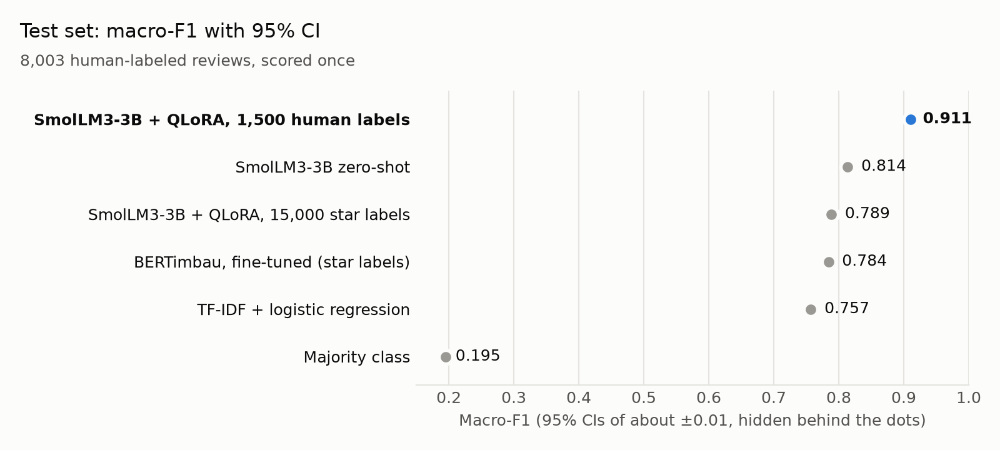
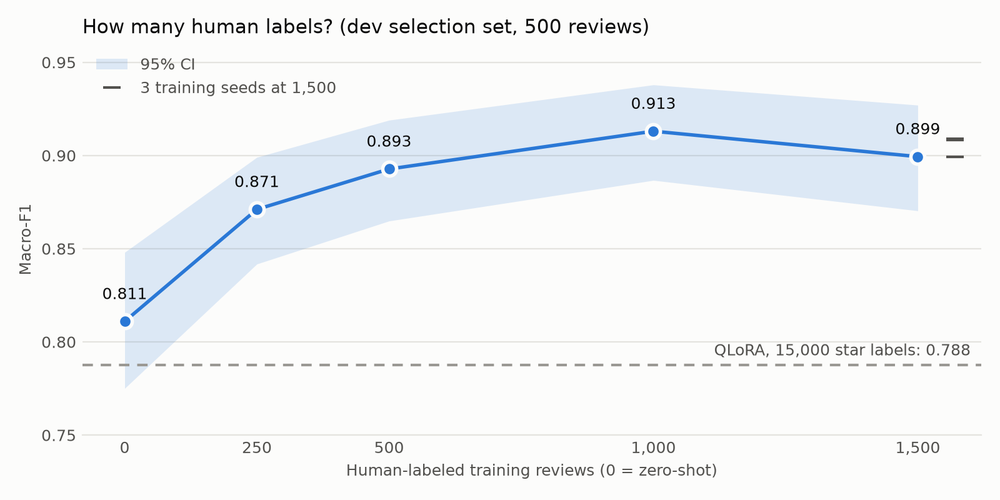

# ptbr-review-lora

**English** | [Português](README.pt-BR.md)

[](https://github.com/PedroRicci12/ptbr-review-lora/actions/workflows/tests.yml)
[](LICENSE)

QLoRA fine-tuning of a small open LLM (SmolLM3-3B) to classify Brazilian Portuguese product
reviews as **negative**, **neutral** or **positive**, compared against the same model without
fine-tuning and against simpler baselines, on a free Kaggle T4 GPU.

**Model on Hugging Face:**
[PedroRicci12/smollm3-3b-ptbr-review-sentiment-qlora](https://huggingface.co/PedroRicci12/smollm3-3b-ptbr-review-sentiment-qlora)
· **Article (pt-BR):** [docs/article.md](docs/article.md)

## TL;DR



- **1,500 human labels were worth more than 15,000 star ratings.** QLoRA on 1,500 human-labeled
  reviews reached **macro-F1 0.911** on 8,003 held-out reviews, +0.097 over the same model
  zero-shot. QLoRA on 15,000 star-derived labels made the model *worse* than zero-shot (−0.025).
  Both results come from comparisons pre-registered before the single test run.
- **The base LLM was the strongest baseline:** zero-shot SmolLM3-3B (0.814) beat a fine-tuned
  BERTimbau (0.784) without any training.
- **Few labels go a long way:** on dev, 250 human labels already beat zero-shot, and gains
  flattened after about 500.
- **Negative results are kept:** 6-shot prompting, star-label fine-tuning and 4-bit loading without
  training all scored below zero-shot, and one of my own explanations turned out wrong (see
  [Ablations](#ablations-dev-selection-set-500-reviews)).

Every number in this README comes from a JSON report in [reports/](reports/), produced by the
script or notebook named next to it. Design decisions, alternatives and incidents are logged in
[docs/decisions.md](docs/decisions.md) (pt-BR).

## Goal

Measure whether parameter-efficient fine-tuning (LoRA/QLoRA) of a small LLM improves
sentiment classification in pt-BR over:

1. the same model without fine-tuning (zero-shot / few-shot prompting);
2. classical (TF-IDF) and encoder-based (BERTimbau) baselines.

## Data

| Role | Dataset | Labels | Size |
|---|---|---|---|
| Training pool | [B2W-Reviews01](https://github.com/americanas-tech/b2w-reviews01) (Americanas.com, 2018) | 1–5 stars → 3 classes | 118,093 |
| Dev (analysis and tuning) | [RePro](https://huggingface.co/datasets/lucasnil/repro), stratified split | human-annotated polarity | 2,000 |
| Test (final evaluation only) | RePro, stratified split | human-annotated polarity | 8,003 |

- Stars: 1–2 → `negativo`, 3 → `neutro`, 4–5 → `positivo`. RePro: reviews annotated as both
  negative and positive ("mixed") count as `neutro`.
- RePro is a subset of B2W: all 10,003 RePro reviews were removed from the training pool, plus
  130 pool reviews whose text is identical to a RePro text.
- Reviewer profile fields (birth year, gender, state) are dropped on load.
- Both datasets are CC BY-NC-SA 4.0, so models trained here are non-commercial.
- On dev, star-derived labels agree with human labels in **74.4%** of reviews (measured).

Counts per split: [reports/data_summary.json](reports/data_summary.json).
Rationale: decisions D5–D9 in [docs/decisions.md](docs/decisions.md).

## Evaluation

- **Main metric:** macro-F1 over the 3 classes. Secondary: accuracy, per-class F1, confusion
  matrix, and recall of `neutro` split into pure-neutral and mixed reviews.
- **Uncertainty:** 95% percentile bootstrap (1,000 resamples); models are compared with a
  paired bootstrap on the same resamples.
- **Protocol:** every choice is made on dev. The test set is used once, at the end, for all
  frozen models together, with the comparisons and the verdict rule committed beforehand.

## Results

### Final results on the test set

8,003 human-labeled RePro reviews, never used for any choice and evaluated once, with comparisons
pre-registered in [src/ptbr_review_lora/protocol.py](src/ptbr_review_lora/protocol.py) before the
run (decision D17); from [reports/test_results.json](reports/test_results.json):

| Model | Macro-F1 (95% CI) | Accuracy | F1 `neutro` |
|---|---|---|---|
| Majority class (`positivo`) | 0.195 (0.191–0.198) | 0.413 | 0.000 |
| TF-IDF + LR, title + text, balanced | 0.757 (0.747–0.766) | 0.785 | 0.558 |
| BERTimbau base, fine-tuned (star labels) | 0.784 (0.775–0.793) | 0.803 | 0.618 |
| SmolLM3-3B + QLoRA, 15,000 star labels | 0.789 (0.780–0.798) | 0.810 | 0.618 |
| SmolLM3-3B zero-shot (no fine-tuning) | 0.814 (0.804–0.823) | 0.850 | 0.634 |
| **SmolLM3-3B + QLoRA, 1,500 human labels** | **0.911** (0.904–0.917) | **0.920** | **0.846** |

Pre-registered comparisons (paired bootstrap, 10,000 resamples, Bonferroni-corrected 98.3% CIs):

| | Comparison | Difference (98.3% CI) | Verdict |
|---|---|---|---|
| H1 | QLoRA human labels vs zero-shot | +0.097 (+0.086 to +0.109) | better |
| H2 | QLoRA star labels vs zero-shot | −0.025 (−0.037 to −0.013) | **worse** |
| H3 | QLoRA human labels vs QLoRA star labels | +0.122 (+0.110 to +0.134) | better |

- Fine-tuning helped only with good labels: 1,500 human labels added ~10 points over zero-shot,
  while 15,000 star labels made the model slightly worse than using no fine-tuning at all.
- Zero-shot vs fine-tuned BERTimbau (descriptive, not pre-registered as a hypothesis): +0.029
  (paired 95% CI +0.019 to +0.040).
- The test confirms dev for every model (differences of at most 0.012 macro-F1); on dev, H2 was
  inconclusive, and the larger test set settles it as a small loss.
- The human-label model was trained on RePro reviews (a different split from test), so it learned the
  same annotation scheme the test uses; the baselines learned from star ratings.

### Development results

**Results on dev** (2,000 reviews; from
[reports/baselines_dev.json](reports/baselines_dev.json),
[reports/bertimbau_dev.json](reports/bertimbau_dev.json) and
[reports/smollm3_base_dev.json](reports/smollm3_base_dev.json)):

| Model | Macro-F1 (95% CI) | Accuracy | F1 `neutro` |
|---|---|---|---|
| Majority class (`positivo`) | 0.195 (0.187–0.202) | 0.413 | 0.000 |
| TF-IDF + logistic regression, text | 0.672 (0.651–0.693) | 0.765 | — |
| TF-IDF + LR, title + text, balanced class weights | 0.762 (0.741–0.779) | 0.793 | 0.560 |
| BERTimbau base, fine-tuned (1 epoch, balanced loss) | 0.787 (0.768–0.804) | 0.807 | 0.621 |
| SmolLM3-3B, no fine-tuning, 6-shot | 0.760 (0.740–0.778) | 0.801 | 0.535 |
| SmolLM3-3B, no fine-tuning, zero-shot | **0.815** (0.795–0.833) | 0.851 | 0.638 |

- Adding the title and balancing class weights both helped TF-IDF (paired bootstrap, 95% CI of
  the difference above zero).
- Fine-tuned BERTimbau beats the best TF-IDF by +0.026 macro-F1 (paired 95% CI +0.009 to
  +0.042), almost all of it on `neutro`. It trained for ~25 min on a Kaggle T4 vs ~25 s on a
  laptop CPU for TF-IDF. A second epoch lowered training loss but also dev macro-F1
  (0.787 → 0.774), so epoch 1 was kept.
- The base LLM in zero-shot beats fine-tuned BERTimbau by +0.028 macro-F1 (paired 95% CI
  +0.007 to +0.050). Adding 6 examples to the prompt made it worse (−0.055), so zero-shot was kept.
- Label scoring and free generation agree on 99.85% of reviews; 0% of generated answers were invalid.
- All these configurations were selected on dev, so their dev scores are optimistic.
  Details: decisions D13–D15 in [docs/decisions.md](docs/decisions.md).

**QLoRA fine-tuning, on the 500-review selection part of dev** (the other 1,500 dev reviews are
training data for the human-label run; from
[reports/smollm3_qlora_human_select.json](reports/smollm3_qlora_human_select.json)):

| Model (same 500 reviews) | Macro-F1 (95% CI) | F1 `neutro` |
|---|---|---|
| TF-IDF + LR, best | 0.762 (0.724–0.796) | 0.554 |
| BERTimbau, fine-tuned | 0.792 (0.756–0.827) | 0.620 |
| SmolLM3-3B zero-shot (fp16) | 0.811 (0.775–0.848) | 0.627 |
| SmolLM3-3B in 4 bits, before training | 0.706 (0.666–0.748) | 0.355 |
| SmolLM3-3B + QLoRA, 15,000 star labels | 0.788 (0.752–0.823) | 0.603 |
| **SmolLM3-3B + QLoRA, 1,500 human labels** | **0.899** (0.870–0.927) | **0.822** |

- **1,500 human labels beat 15,000 star labels by +0.112 macro-F1** (paired 95% CI +0.070 to
  +0.151), with a tenth of the examples and under a third of the training time.
- QLoRA on star labels did not beat zero-shot (−0.023, CI −0.059 to +0.013) and tied with
  BERTimbau, agreeing with it on 95.4% of reviews: with the same noisy labels, a 110M encoder and
  a 3B LLM learn almost the same thing.
- QLoRA on human labels adds +0.088 over zero-shot (CI +0.048 to +0.129), almost all on `neutro`.
- Loading the model in 4 bits alone cost 0.105 macro-F1 before training (neutral nearly vanished).
  Details: decision D16.

### Ablations (dev selection set, 500 reviews)

Exploratory (95% CIs, no multiple-comparison correction); the test set is not used again. Details:
decision D18 in [docs/decisions.md](docs/decisions.md).



**Learning curve** (QLoRA, nested stratified subsets of the 1,500 human labels, training seed 42;
from [reports/ablation_learning_curve_select.json](reports/ablation_learning_curve_select.json)):

| Human labels | Macro-F1 (95% CI) | F1 `neutro` | Training time |
|---|---|---|---|
| 0 (zero-shot) | 0.811 (0.775–0.848) | 0.627 | — |
| 250 | 0.871 (0.842–0.899) | 0.766 | 15 min |
| 500 | 0.893 (0.865–0.919) | 0.807 | 21 min |
| 1,000 | 0.913 (0.887–0.938) | 0.843 | 31 min |
| 1,500 (Stage 5) | 0.899 (0.870–0.927) | 0.822 | — |

- 250 human labels already beat zero-shot by +0.060 (CI +0.025 to +0.094).
- Gains flatten after ~500 labels: none of 250/500/1,000 differs from 1,500 with a CI clear of
  zero, and the gaps are about the size of the seed variation below.

**Seed variance** (same 1,500 labels, training seeds 42/43/44; from
[reports/ablation_seeds_select.json](reports/ablation_seeds_select.json)):

| Training seed | Macro-F1 (95% CI) | F1 `neutro` | Best step (of 279) |
|---|---|---|---|
| 42 (Stage 5, published) | 0.899 (0.870–0.927) | 0.822 | 70 |
| 43 | 0.908 (0.881–0.934) | 0.840 | 209 |
| 44 | 0.909 (0.880–0.934) | 0.843 | 279 |

- Mean 0.906, std 0.005: the Stage 5 result was not a lucky seed (seed 42 was the lowest), and
  every seed beats zero-shot by about +0.09 to +0.10.
- The best checkpoint moves with the seed, so "best after under one epoch" was specific to seed 42.
- Seed noise (std 0.005) is much smaller than the uncertainty from 500 evaluation reviews (±0.03).

**Few-shot examples** (base model, no training; from
[reports/ablation_few_shot_select.json](reports/ablation_few_shot_select.json)):

| Prompt | Macro-F1 (95% CI) | F1 `neutro` |
|---|---|---|
| Zero-shot | 0.811 (0.775–0.848) | 0.627 |
| 6-shot, human-labeled examples | 0.799 (0.759–0.833) | 0.626 |
| 6-shot, star-labeled examples, draw seed 1 | 0.791 (0.751–0.823) | 0.613 |
| 6-shot, star-labeled examples, draw seed 2 | 0.783 (0.743–0.817) | 0.582 |
| 6-shot, star-labeled examples, draw seed 42 (Stage 4) | 0.741 (0.702–0.778) | 0.488 |

- The Stage 4 draw was the worst of three (star draws: mean 0.772, std 0.027). Most of the 6-shot
  drop came from that draw, not from noisy example labels as I had assumed.
- Human-labeled examples did not beat zero-shot (−0.012, CI −0.043 to +0.018). Human labels only
  paid off through fine-tuning.

### Published model check

The adapter downloaded from the Hub has the same sha256 as the evaluated one, and the model card's
usage example, run unchanged, reproduced all 500 selection-set predictions of Stage 5 (macro-F1
0.8994, 0 differences); from [reports/hub_check_select.json](reports/hub_check_select.json),
decision D19.

## Limitations

- **Same annotation scheme:** the human-label model was trained on RePro reviews and tested on a
  different RePro split, so part of its gain may be learning that annotation, not only "better"
  labels. No verified out-of-domain pt-BR dataset with 3 human-annotated classes was found to test
  this (D18).
- **Possible contamination:** both datasets are public, and SmolLM3's pre-training data was not
  checked for them; that could inflate the zero-shot score.
- **Domain:** e-commerce product reviews from one store, written in 2018. Other domains and other
  varieties of Portuguese were not evaluated.
- **Artificial class balance:** RePro sampled ~2,000 reviews per star rating, so accuracy does not
  reflect real-world traffic; macro-F1 is the main metric.
- **Noisy star labels:** on dev they agree with human labels in 74.4% of reviews, which is the
  premise of the comparison, not a bug.
- **Small selection set:** QLoRA runs were compared on 500 dev reviews (only 20 pure-neutral), so
  their intervals are about twice as wide as on the full dev, and checkpoints were chosen on the
  same 500.
- **One seed on the test set:** each test-set model was trained once; seed variance was measured
  only for the human-label run, on dev. BERTimbau and TF-IDF used standard, untuned
  hyperparameters, so they are reasonable baselines, not optimal ones.
- **Near-duplicates:** only exact text duplicates between training and evaluation were removed.
- Few-shot prompting was never run on the test set: it lost to zero-shot on dev with one draw of
  6 examples (Stage 4), and three draws were compared later, also on dev (see Ablations).

## Learnings

- **Stage 1 — non-ASCII paths break editable installs on Python 3.12 / Windows.**
  With the project under `...\Área de Trabalho\...`, `uv run` failed with
  `UnicodeDecodeError: 'charmap' codec can't decode byte 0x81`. The editable install writes
  the path to `src/` into a `.pth` file as UTF-8 (`Á` = `C3 81`), but Python 3.12 on Windows
  reads `.pth` files with the locale encoding (cp1252), where `0x81` is undefined.
  Fix: move the project to a path without accents (and outside OneDrive). See D4 in
  [docs/decisions.md](docs/decisions.md).
- **Stage 2 — check data facts in the data itself.** The B2W "dataset" on the Hugging Face Hub
  is only a loading script (no data), so the CSV is downloaded from the original GitHub source.
  The source description suggested a `;` separator, but the file uses `,`: reading the header
  settled it. Removing RePro from the training pool by ID was not enough either: 92 RePro texts
  still appeared verbatim in the pool (same review posted for different products, probably).
- **Stage 3 — a cheap baseline sets the bar.** TF-IDF + logistic regression trained in ~25 s
  reaches 0.762 macro-F1 on dev, and its 79% accuracy is already above the 74% agreement between
  star labels and human labels. Balancing class weights mattered most: it raised recall of
  pure-neutral reviews from 7% to 38%, because neutral is 12% of training but 24% of evaluation.
- **Stage 3b — a stronger model buys a small, measurable gain; the GPU is the bottleneck.**
  Fine-tuned BERTimbau beat TF-IDF by 2.6 macro-F1 points, with a paired bootstrap CI that
  excludes zero, at ~60× the training time. More training was not better: epoch 2 lowered training
  loss but also dev macro-F1. Free Colab had no GPU available, so the notebook was made to run on
  Kaggle too; the data check (rebuilt counts must match the repository) passed under a different
  pandas version, which is what makes the cross-platform run trustworthy.
- **Stage 4 — measure the base model before fine-tuning it; it can be the strongest baseline.**
  SmolLM3-3B with only an instruction beat every trained model on dev, and adding examples to the
  prompt made it worse, which is the opposite of the usual intuition. Reading the chat template
  also mattered: by default it writes today's date into the prompt, which silently breaks
  reproducibility. Scoring labels and generating answers gave almost identical predictions, so
  for this model the answer format was not a problem.
- **Stage 5 — label quality beat data size and model size.** Before training, measuring the label
  noise showed it was systematic (3-star reviews are often positive for humans), so two runs were
  compared: 1,500 human labels won by 11 points over 15,000 star labels. The star-label QLoRA model
  agreed with BERTimbau on 95% of reviews: the labels, more than the architecture, decided what was
  learned. Also unexpected: quantizing to 4 bits cost 10 points before any training.
- **Stage 6 — decide how to read the test before reading it.** The three hypotheses, the Bonferroni
  correction and the verdict rule were committed before the single test run, so no comparison could
  be picked after seeing the numbers. The test agreed with dev within 0.012 for every model, and its
  larger size turned an inconclusive dev result (star-label fine-tuning) into a measurable loss.
- **Stage 7 — test your own explanations.** My Stage 4 explanation (6-shot lost because of noisy
  example labels) was wrong: it was mostly an unlucky draw. Repeating a run with other seeds or draws
  is cheap insurance before writing a story about one number. The seeds also showed which findings
  were general (human labels win) and which were specific to one run (the early best checkpoint).
- **Stage 8 — publish what you measured, and prove it.** Generating the model card from the
  reports caught two numbers I had rounded wrong by hand. Publishing only the adapter kept the
  artifact identical to the evaluated one, and running the card's own code from the Hub reproduced
  all 500 dev predictions, so the page's claims are checked, not just written.

## Reproduce

### Installation

Requirements: Python 3.12 and [uv](https://docs.astral.sh/uv/). GPU steps run on a free Kaggle
(or Colab) T4; nothing here trains on a CPU.

```bash
git clone https://github.com/PedroRicci12/ptbr-review-lora.git
cd ptbr-review-lora
uv sync
cp .env.example .env   # only needed to publish to Hugging Face
```

### Local steps (CPU)

Run the tests:

```bash
uv run pytest
```

Download (~55 MB, pinned and checksum-verified) and prepare the data:

```bash
uv run python scripts/prepare_data.py
```

Train the classical baselines and evaluate them on dev (~2 minutes on a laptop CPU):

```bash
uv run python scripts/run_baselines.py
```

Rebuild the model card and the figures from the reports:

```bash
uv run python scripts/build_model_card.py
uv run --group figures python scripts/make_figures.py
```

### GPU notebooks (Kaggle or Colab)

Each notebook clones this repository, rebuilds the data and stops if the counts differ from
[reports/data_summary.json](reports/data_summary.json).

- **Kaggle:** import the notebook from GitHub (*File → Import Notebook*), set *Accelerator →
  GPU T4 x2* and *Internet → on*, then *Save Version → Save & Run All*; the zip is in the
  version's *Output* tab. A phone-verified Kaggle account is required for GPUs.
- **Google Colab:** open the notebook from GitHub, select a T4 GPU and run all cells; the browser
  downloads the zip.

Unzip each results zip at the repository root: the files land in `reports/` and `predictions/`.

| Notebook | What it does | Output |
|---|---|---|
| [03b_bertimbau.ipynb](notebooks/03b_bertimbau.ipynb) | Fine-tunes the BERTimbau baseline | `bertimbau_results.zip` |
| [04_base_llm.ipynb](notebooks/04_base_llm.ipynb) | SmolLM3-3B zero-shot and 6-shot | `smollm3_base_results.zip` |
| [05_qlora.ipynb](notebooks/05_qlora.ipynb) | QLoRA; set `TRAINING_SET = "stars"` or `"human"` | `qlora_<set>_results.zip`, `qlora_<set>_adapter.zip` (keep outside the repository) |
| [07_ablations.ipynb](notebooks/07_ablations.ipynb) | Set `EXPERIMENT = "learning_curve"`, `"seeds"` or `"few_shot"`; dev only | `ablation_<experiment>_results.zip` |
| [08_hub_check.ipynb](notebooks/08_hub_check.ipynb) | Checks the published adapter from the Hub; dev only | `hub_check_results.zip` |

The single test-set evaluation (Stage 6) is [scripts/evaluate_test.py](scripts/evaluate_test.py);
it refuses to run again once `reports/test_results.json` exists.

### Publish (Hugging Face)

Needs a write `HF_TOKEN` in `.env`; the repository is created private:

```bash
uv run --group publish python scripts/publish_hf.py --adapter-dir <unzipped qlora_human_adapter>
```

## Repository structure

```
├── src/ptbr_review_lora/   # reusable code (data, prompts, training helpers, metrics, protocol)
├── scripts/                # command-line entry points (data, baselines, test, card, figures, publish)
├── notebooks/              # Kaggle/Colab notebooks (GPU training and inference)
├── reports/                # result files (counts and metrics only, no review text)
├── predictions/            # per-review predicted labels (row number + label, no text)
├── figures/                # PNGs generated from reports/ (en and pt-BR)
├── model_card/             # Hugging Face model card: templates, usage example, generated cards
├── tests/                  # pytest tests (run by GitHub Actions)
└── docs/decisions.md       # design decisions, alternatives and incidents (pt-BR)
```

## License

- **Code** (`src/`, `scripts/`, `notebooks/`, `tests/`, `model_card/*.py`): [MIT](LICENSE).
- **Data-derived artifacts** (`predictions/`, the published adapter and its model card):
  [CC BY-NC-SA 4.0](https://creativecommons.org/licenses/by-nc-sa/4.0/), inherited from
  [B2W-Reviews01](https://github.com/americanas-tech/b2w-reviews01) and
  [RePro](https://huggingface.co/datasets/lucasnil/repro); non-commercial use only.
- The datasets are not redistributed here: `scripts/prepare_data.py` downloads them from their
  sources. The base model, SmolLM3-3B, is Apache 2.0.
