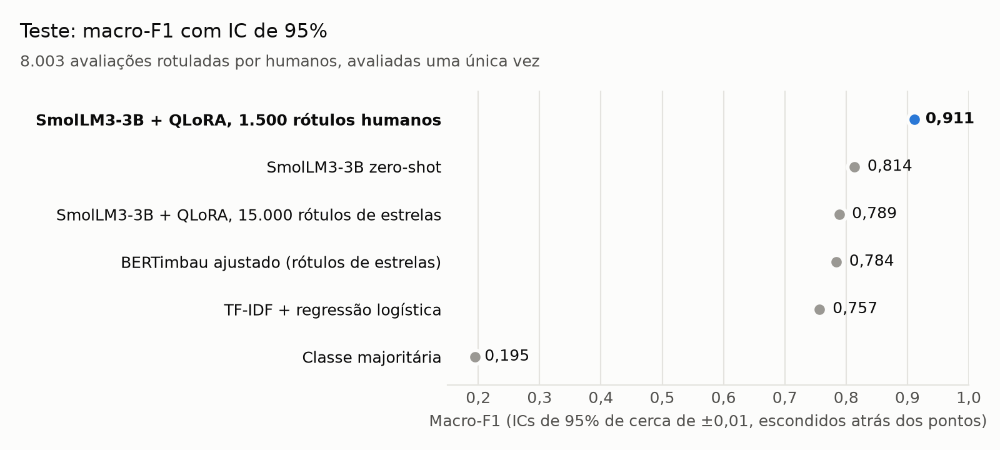
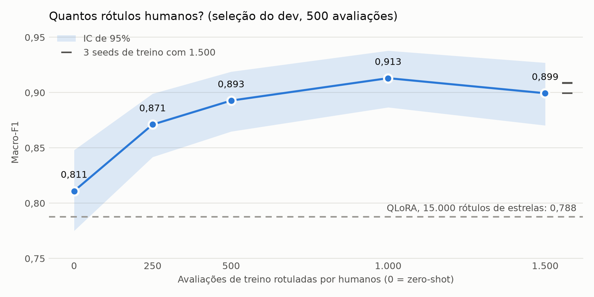

# ptbr-review-lora

[English](README.md) | **Português**

[](https://github.com/PedroRicci12/ptbr-review-lora/actions/workflows/tests.yml)
[](LICENSE)

Fine-tuning com QLoRA de um LLM aberto pequeno (SmolLM3-3B) para classificar avaliações de
produtos em português do Brasil como **negativa**, **neutra** ou **positiva**, comparado com o
mesmo modelo sem fine-tuning e com baselines mais simples, numa GPU T4 gratuita do Kaggle.

**Modelo no Hugging Face:**
[PedroRicci12/smollm3-3b-ptbr-review-sentiment-qlora](https://huggingface.co/PedroRicci12/smollm3-3b-ptbr-review-sentiment-qlora)

## Resumo



- **1.500 rótulos humanos valeram mais que 15.000 notas em estrelas.** O QLoRA com 1.500
  avaliações rotuladas por humanos chegou a **macro-F1 0,911** em 8.003 avaliações de teste,
  +0,097 acima do mesmo modelo em zero-shot. O QLoRA com 15.000 rótulos derivados das estrelas
  deixou o modelo *pior* que o zero-shot (−0,025). Os dois resultados vêm de comparações
  pré-registradas antes da única execução no teste.
- **O LLM base foi a baseline mais forte:** o SmolLM3-3B em zero-shot (0,814) superou o BERTimbau
  ajustado (0,784) sem nenhum treino.
- **Poucos rótulos rendem muito:** no dev, 250 rótulos humanos já superaram o zero-shot, e o
  ganho achatou depois de cerca de 500.
- **Os resultados negativos ficaram:** o prompt 6-shot, o fine-tuning com estrelas e o modelo em
  4 bits sem treino ficaram abaixo do zero-shot, e uma explicação minha se mostrou errada (ver
  [Ablações](#ablações-parte-de-seleção-do-dev-500-avaliações)).

Todo número deste README vem de um relatório JSON em [reports/](reports/), gerado pelo script ou
notebook citado ao lado. Decisões de design, alternativas e incidentes estão registrados em
[docs/decisions.md](docs/decisions.md).

## Objetivo

Medir se o fine-tuning eficiente em parâmetros (LoRA/QLoRA) de um LLM pequeno melhora a
classificação de sentimento em pt-BR em relação a:

1. o mesmo modelo sem fine-tuning (prompting zero-shot / few-shot);
2. baselines clássica (TF-IDF) e baseada em encoder (BERTimbau).

## Dados

| Papel | Dataset | Rótulos | Tamanho |
|---|---|---|---|
| Pool de treino | [B2W-Reviews01](https://github.com/americanas-tech/b2w-reviews01) (Americanas.com, 2018) | 1–5 estrelas → 3 classes | 118.093 |
| Dev (análise e ajustes) | [RePro](https://huggingface.co/datasets/lucasnil/repro), divisão estratificada | polaridade anotada por humanos | 2.000 |
| Teste (só avaliação final) | RePro, divisão estratificada | polaridade anotada por humanos | 8.003 |

- Estrelas: 1–2 → `negativo`, 3 → `neutro`, 4–5 → `positivo`. RePro: avaliações anotadas como
  negativas e positivas ao mesmo tempo ("misto") contam como `neutro`.
- O RePro é um subconjunto da B2W: as 10.003 avaliações do RePro foram removidas do pool de
  treino, além de 130 avaliações do pool com texto idêntico a um texto do RePro.
- Os campos de perfil do avaliador (ano de nascimento, gênero, estado) são descartados no carregamento.
- Os dois datasets são CC BY-NC-SA 4.0, então os modelos treinados aqui são não comerciais.
- No dev, o rótulo das estrelas concorda com o rótulo humano em **74,4%** das avaliações (medido).

Contagens por split: [reports/data_summary.json](reports/data_summary.json).
Justificativas: decisões D5–D9 em [docs/decisions.md](docs/decisions.md).

## Avaliação

- **Métrica principal:** macro-F1 sobre as 3 classes. Secundárias: acurácia, F1 por classe,
  matriz de confusão e recall do `neutro` separado em neutro puro e misto.
- **Incerteza:** bootstrap de percentis com 95% (1.000 reamostras); modelos são comparados com
  bootstrap pareado nas mesmas reamostras.
- **Protocolo:** toda escolha é feita no dev. O teste é usado uma única vez, no fim, para todos
  os modelos congelados juntos, com as comparações e a regra de veredito commitadas antes.

## Resultados

### Resultados finais no teste

8.003 avaliações do RePro rotuladas por humanos, nunca usadas para nenhuma escolha e avaliadas uma
única vez, com as comparações pré-registradas em
[src/ptbr_review_lora/protocol.py](src/ptbr_review_lora/protocol.py) antes da execução (decisão D17);
de [reports/test_results.json](reports/test_results.json):

| Modelo | Macro-F1 (IC 95%) | Acurácia | F1 `neutro` |
|---|---|---|---|
| Classe majoritária (`positivo`) | 0,195 (0,191–0,198) | 0,413 | 0,000 |
| TF-IDF + RL, título + texto, balanceada | 0,757 (0,747–0,766) | 0,785 | 0,558 |
| BERTimbau base ajustado (rótulos de estrelas) | 0,784 (0,775–0,793) | 0,803 | 0,618 |
| SmolLM3-3B + QLoRA, 15.000 rótulos de estrelas | 0,789 (0,780–0,798) | 0,810 | 0,618 |
| SmolLM3-3B zero-shot (sem fine-tuning) | 0,814 (0,804–0,823) | 0,850 | 0,634 |
| **SmolLM3-3B + QLoRA, 1.500 rótulos humanos** | **0,911** (0,904–0,917) | **0,920** | **0,846** |

Comparações pré-registradas (bootstrap pareado, 10.000 reamostras, IC de 98,3% com Bonferroni):

| | Comparação | Diferença (IC 98,3%) | Veredito |
|---|---|---|---|
| H1 | QLoRA rótulos humanos vs zero-shot | +0,097 (+0,086 a +0,109) | melhor |
| H2 | QLoRA rótulos de estrelas vs zero-shot | −0,025 (−0,037 a −0,013) | **pior** |
| H3 | QLoRA rótulos humanos vs QLoRA estrelas | +0,122 (+0,110 a +0,134) | melhor |

- O fine-tuning só ajudou com rótulos bons: 1.500 rótulos humanos somaram ~10 pontos ao zero-shot,
  enquanto 15.000 rótulos de estrelas deixaram o modelo um pouco pior do que sem fine-tuning.
- Zero-shot vs BERTimbau ajustado (descritivo, não pré-registrado como hipótese): +0,029 (IC
  pareado de 95%: +0,019 a +0,040).
- O teste confirma o dev em todos os modelos (diferenças de no máximo 0,012 de macro-F1); no dev a H2
  era inconclusiva, e o teste, maior, mostra uma pequena perda.
- O modelo com rótulos humanos treinou com avaliações do RePro (uma divisão diferente do teste),
  então aprendeu o mesmo esquema de anotação que o teste usa; as baselines aprenderam com estrelas.

### Resultados de desenvolvimento

**Resultados no dev** (2.000 avaliações; de
[reports/baselines_dev.json](reports/baselines_dev.json),
[reports/bertimbau_dev.json](reports/bertimbau_dev.json) e
[reports/smollm3_base_dev.json](reports/smollm3_base_dev.json)):

| Modelo | Macro-F1 (IC 95%) | Acurácia | F1 `neutro` |
|---|---|---|---|
| Classe majoritária (`positivo`) | 0,195 (0,187–0,202) | 0,413 | 0,000 |
| TF-IDF + regressão logística, texto | 0,672 (0,651–0,693) | 0,765 | — |
| TF-IDF + RL, título + texto, pesos balanceados | 0,762 (0,741–0,779) | 0,793 | 0,560 |
| BERTimbau base ajustado (1 época, perda balanceada) | 0,787 (0,768–0,804) | 0,807 | 0,621 |
| SmolLM3-3B sem fine-tuning, 6-shot | 0,760 (0,740–0,778) | 0,801 | 0,535 |
| SmolLM3-3B sem fine-tuning, zero-shot | **0,815** (0,795–0,833) | 0,851 | 0,638 |

- Incluir o título e balancear os pesos das classes ajudou a TF-IDF (bootstrap pareado, IC de
  95% da diferença acima de zero).
- O BERTimbau ajustado supera a melhor TF-IDF em +0,026 de macro-F1 (IC pareado de 95%: +0,009
  a +0,042), quase tudo no `neutro`. Treinou em ~25 min numa T4 do Kaggle, contra ~25 s da TF-IDF
  na CPU de um notebook. Uma segunda época baixou a perda de treino, mas também o macro-F1 no dev
  (0,787 → 0,774), então ficou a época 1.
- O LLM base em zero-shot supera o BERTimbau ajustado em +0,028 de macro-F1 (IC pareado de 95%:
  +0,007 a +0,050). Colocar 6 exemplos no prompt piorou (−0,055), então ficou o zero-shot.
- Pontuar os rótulos e gerar a resposta concordam em 99,85% das avaliações; 0% das respostas
  geradas foram inválidas.
- Todas essas configurações foram escolhidas no dev, então os números delas no dev são otimistas.
  Detalhes: decisões D13–D15 em [docs/decisions.md](docs/decisions.md).

**Fine-tuning com QLoRA, na parte de seleção do dev (500 avaliações)** (as outras 1.500 do dev são
o treino da versão com rótulos humanos; de
[reports/smollm3_qlora_human_select.json](reports/smollm3_qlora_human_select.json)):

| Modelo (mesmas 500 avaliações) | Macro-F1 (IC 95%) | F1 `neutro` |
|---|---|---|
| TF-IDF + RL, melhor | 0,762 (0,724–0,796) | 0,554 |
| BERTimbau ajustado | 0,792 (0,756–0,827) | 0,620 |
| SmolLM3-3B zero-shot (fp16) | 0,811 (0,775–0,848) | 0,627 |
| SmolLM3-3B em 4 bits, antes do treino | 0,706 (0,666–0,748) | 0,355 |
| SmolLM3-3B + QLoRA, 15.000 rótulos de estrelas | 0,788 (0,752–0,823) | 0,603 |
| **SmolLM3-3B + QLoRA, 1.500 rótulos humanos** | **0,899** (0,870–0,927) | **0,822** |

- **1.500 rótulos humanos superam 15.000 rótulos de estrelas em +0,112 de macro-F1** (IC pareado
  de 95%: +0,070 a +0,151), com um décimo dos exemplos e menos de um terço do tempo de treino.
- O QLoRA com estrelas não superou o zero-shot (−0,023, IC −0,059 a +0,013) e empatou com o
  BERTimbau, concordando com ele em 95,4% das avaliações: com os mesmos rótulos ruidosos, um
  encoder de 110M e um LLM de 3B aprendem quase a mesma coisa.
- O QLoRA com rótulos humanos soma +0,088 ao zero-shot (IC +0,048 a +0,129), quase tudo no `neutro`.
- Só carregar o modelo em 4 bits custou 0,105 de macro-F1 antes do treino (o neutro quase sumiu).
  Detalhes: decisão D16.

### Ablações (parte de seleção do dev, 500 avaliações)

Exploratórias (IC de 95%, sem correção para múltiplas comparações); o teste não é usado de novo.
Detalhes: decisão D18 em [docs/decisions.md](docs/decisions.md).



**Curva de aprendizado** (QLoRA, subconjuntos aninhados e estratificados dos 1.500 rótulos humanos,
seed de treino 42; de
[reports/ablation_learning_curve_select.json](reports/ablation_learning_curve_select.json)):

| Rótulos humanos | Macro-F1 (IC 95%) | F1 `neutro` | Tempo de treino |
|---|---|---|---|
| 0 (zero-shot) | 0,811 (0,775–0,848) | 0,627 | — |
| 250 | 0,871 (0,842–0,899) | 0,766 | 15 min |
| 500 | 0,893 (0,865–0,919) | 0,807 | 21 min |
| 1.000 | 0,913 (0,887–0,938) | 0,843 | 31 min |
| 1.500 (Etapa 5) | 0,899 (0,870–0,927) | 0,822 | — |

- Com só 250 rótulos humanos o QLoRA já supera o zero-shot em +0,060 (IC +0,025 a +0,094).
- O ganho achata depois de ~500 rótulos: nenhum de 250/500/1.000 difere dos 1.500 com IC longe do
  zero, e as diferenças têm o tamanho da variação entre seeds abaixo.

**Variância entre seeds** (os mesmos 1.500 rótulos, seeds de treino 42/43/44; de
[reports/ablation_seeds_select.json](reports/ablation_seeds_select.json)):

| Seed de treino | Macro-F1 (IC 95%) | F1 `neutro` | Melhor passo (de 279) |
|---|---|---|---|
| 42 (Etapa 5, publicada) | 0,899 (0,870–0,927) | 0,822 | 70 |
| 43 | 0,908 (0,881–0,934) | 0,840 | 209 |
| 44 | 0,909 (0,880–0,934) | 0,843 | 279 |

- Média 0,906, desvio 0,005: o resultado da Etapa 5 não foi sorte de seed (a 42 foi a mais baixa),
  e todas as seeds superam o zero-shot em cerca de +0,09 a +0,10.
- O melhor checkpoint muda com a seed; o "melhor com menos de 1 época" era da seed 42.
- O ruído entre seeds (desvio 0,005) é bem menor que a incerteza das 500 avaliações (±0,03).

**Exemplos do few-shot** (modelo base, sem treino; de
[reports/ablation_few_shot_select.json](reports/ablation_few_shot_select.json)):

| Prompt | Macro-F1 (IC 95%) | F1 `neutro` |
|---|---|---|
| Zero-shot | 0,811 (0,775–0,848) | 0,627 |
| 6-shot, exemplos com rótulos humanos | 0,799 (0,759–0,833) | 0,626 |
| 6-shot, exemplos com rótulos de estrelas, sorteio seed 1 | 0,791 (0,751–0,823) | 0,613 |
| 6-shot, exemplos com rótulos de estrelas, sorteio seed 2 | 0,783 (0,743–0,817) | 0,582 |
| 6-shot, exemplos com rótulos de estrelas, sorteio seed 42 (Etapa 4) | 0,741 (0,702–0,778) | 0,488 |

- O sorteio da Etapa 4 foi o pior de três (sorteios de estrelas: média 0,772, desvio 0,027). A
  maior parte da queda do 6-shot veio daquele sorteio, e não do ruído dos rótulos dos exemplos,
  como eu tinha suposto.
- Exemplos humanos não superaram o zero-shot (−0,012, IC −0,043 a +0,018). Os rótulos humanos só
  renderam com fine-tuning.

### Verificação do modelo publicado

O adapter baixado do Hub tem o mesmo sha256 do avaliado, e o exemplo de uso do model card, rodado
sem mudanças, reproduziu as 500 predições da Etapa 5 na seleção (macro-F1 0,8994, nenhuma
diferença); de [reports/hub_check_select.json](reports/hub_check_select.json), decisão D19.

## Limitações

- **Mesmo esquema de anotação:** o modelo com rótulos humanos treinou com avaliações do RePro e
  foi testado em outra parte do RePro, então parte do ganho pode ser aprender essa anotação, e não
  só rótulos "melhores". Não achei um dataset em pt-BR de outro domínio, verificado, com 3 classes
  anotadas por humanos para testar isso (D18).
- **Possível contaminação:** os dois datasets são públicos, e não foi verificado se estão nos dados
  de pré-treino do SmolLM3; isso poderia inflar o zero-shot.
- **Domínio:** avaliações de produtos de uma loja, escritas em 2018. Outros domínios e outras
  variedades do português não foram avaliados.
- **Equilíbrio de classes artificial:** o RePro amostrou ~2.000 avaliações por nota, então a
  acurácia não reflete o tráfego real; a métrica principal é o macro-F1.
- **Rótulos de estrelas com ruído:** no dev, concordam com o rótulo humano em 74,4% das
  avaliações. Essa é a premissa da comparação, não um defeito.
- **Conjunto de seleção pequeno:** os treinos de QLoRA foram comparados em 500 avaliações do dev
  (só 20 neutras puras), então os intervalos são cerca de 2× mais largos que no dev inteiro, e os
  checkpoints foram escolhidos nessas mesmas 500.
- **Uma seed no teste:** cada modelo do teste foi treinado uma vez; a variância entre seeds só foi
  medida para o treino com rótulos humanos, no dev. BERTimbau e TF-IDF usaram hiperparâmetros
  padrão, não ajustados: são baselines razoáveis, não ótimas.
- **Quase-duplicatas:** só duplicatas exatas de texto entre treino e avaliação foram removidas.
- O few-shot nunca rodou no teste: perdeu para o zero-shot no dev com um sorteio de 6 exemplos
  (Etapa 4), e três sorteios foram comparados depois, também no dev (ver Ablações).

## Aprendizados

- **Etapa 1 — caminhos com acento quebram a instalação editável no Python 3.12 / Windows.**
  Com o projeto em `...\Área de Trabalho\...`, o `uv run` falhou com
  `UnicodeDecodeError: 'charmap' codec can't decode byte 0x81`. A instalação editável grava
  o caminho de `src/` num arquivo `.pth` em UTF-8 (`Á` = `C3 81`), mas o Python 3.12 no Windows
  lê arquivos `.pth` com a codificação do sistema (cp1252), na qual `0x81` não existe.
  Correção: mover o projeto para um caminho sem acento (e fora do OneDrive). Ver D4 em
  [docs/decisions.md](docs/decisions.md).
- **Etapa 2 — confirmar os fatos sobre os dados nos próprios dados.** O "dataset" da B2W no
  Hugging Face Hub é só um script de carregamento (sem dados), então o CSV é baixado da fonte
  original no GitHub. A descrição da fonte sugeria separador `;`, mas o arquivo usa `,`: ler o
  cabeçalho resolveu. Remover o RePro do pool de treino pelo ID também não bastou: 92 textos do
  RePro ainda apareciam idênticos no pool (provavelmente a mesma avaliação publicada para produtos diferentes).
- **Etapa 3 — uma baseline barata define a régua.** TF-IDF + regressão logística, treinada em
  ~25 s, chega a 0,762 de macro-F1 no dev, e seus 79% de acurácia já superam os 74% de
  concordância entre estrelas e rótulos humanos. O que mais pesou foi balancear os pesos das
  classes: o recall do neutro puro subiu de 7% para 38%, porque o neutro é 12% do treino e 24% da avaliação.
- **Etapa 3b — um modelo mais forte compra um ganho pequeno e mensurável; a GPU é o gargalo.**
  O BERTimbau ajustado superou a TF-IDF em 2,6 pontos de macro-F1, com IC do bootstrap pareado
  excluindo o zero, ao custo de ~60× o tempo de treino. Treinar mais não foi melhor: a época 2
  baixou a perda de treino, mas também o macro-F1 no dev. O Colab gratuito não tinha GPU, então o
  notebook passou a rodar também no Kaggle; a checagem dos dados (contagens reconstruídas iguais
  às do repositório) passou com outra versão do pandas, e é isso que torna confiável rodar em outra plataforma.
- **Etapa 4 — medir o modelo base antes de ajustá-lo; ele pode ser a baseline mais forte.**
  O SmolLM3-3B, só com uma instrução, superou todos os modelos treinados no dev, e colocar exemplos
  no prompt piorou o resultado, o contrário da intuição comum. Ler o chat template também fez
  diferença: por padrão ele escreve a data de hoje no prompt, o que quebra a reprodutibilidade sem
  avisar. Pontuar os rótulos e gerar a resposta deram previsões quase idênticas, então, para este
  modelo, o formato da resposta não foi problema.
- **Etapa 5 — a qualidade do rótulo pesou mais que a quantidade de dados e que o tamanho do modelo.**
  Antes de treinar, medir o ruído dos rótulos mostrou que ele era sistemático (avaliações de 3
  estrelas costumam ser positivas para os humanos), então dois treinos foram comparados: 1.500
  rótulos humanos ganharam por 11 pontos de 15.000 rótulos de estrelas. O QLoRA com estrelas
  concordou com o BERTimbau em 95% das avaliações: os rótulos, mais que a arquitetura, decidiram o
  que foi aprendido. Também inesperado: quantizar para 4 bits custou 10 pontos antes de qualquer treino.
- **Etapa 6 — decidir como ler o teste antes de lê-lo.** As três hipóteses, a correção de
  Bonferroni e a regra de veredito foram commitadas antes da única execução no teste, então
  nenhuma comparação pôde ser escolhida depois de ver os números. O teste concordou com o dev em até
  0,012 para todos os modelos, e o tamanho maior transformou um resultado inconclusivo no dev (o
  fine-tuning com estrelas) numa perda mensurável.
- **Etapa 7 — testar as próprias explicações.** A explicação da Etapa 4 (o 6-shot perdeu pelo ruído
  dos rótulos dos exemplos) estava errada: foi principalmente um sorteio azarado. Repetir um treino
  com outras seeds ou sorteios é um seguro barato antes de contar uma história sobre um número só.
  As seeds também mostraram o que era geral (rótulos humanos vencem) e o que era de um treino só
  (o melhor checkpoint cedo).
- **Etapa 8 — publicar o que foi medido, e provar.** Gerar o model card a partir dos relatórios
  achou dois números que eu tinha arredondado errado à mão. Publicar só o adapter manteve o
  artefato idêntico ao avaliado, e rodar o próprio código do card baixando do Hub reproduziu as 500
  predições do dev, então o que a página afirma foi conferido, e não só escrito.

## Como reproduzir

### Instalação

Requisitos: Python 3.12 e [uv](https://docs.astral.sh/uv/). As etapas com GPU rodam numa T4
gratuita do Kaggle (ou do Colab); nada aqui treina na CPU.

```bash
git clone https://github.com/PedroRicci12/ptbr-review-lora.git
cd ptbr-review-lora
uv sync
cp .env.example .env   # só é preciso para publicar no Hugging Face
```

### Etapas locais (CPU)

Rodar os testes:

```bash
uv run pytest
```

Baixar (~55 MB, com versão fixada e checksum verificado) e preparar os dados:

```bash
uv run python scripts/prepare_data.py
```

Treinar as baselines clássicas e avaliá-las no dev (~2 minutos na CPU de um notebook):

```bash
uv run python scripts/run_baselines.py
```

Gerar de novo o model card e as figuras a partir dos relatórios:

```bash
uv run python scripts/build_model_card.py
uv run --group figures python scripts/make_figures.py
```

### Notebooks com GPU (Kaggle ou Colab)

Cada notebook clona este repositório, reconstrói os dados e para se as contagens forem diferentes
de [reports/data_summary.json](reports/data_summary.json).

- **Kaggle:** importe o notebook do GitHub (*File → Import Notebook*), ajuste *Accelerator →
  GPU T4 x2* e *Internet → on* e clique em *Save Version → Save & Run All*; o zip fica na aba
  *Output* da versão. GPUs no Kaggle exigem conta verificada por celular.
- **Google Colab:** abra o notebook a partir do GitHub, escolha uma GPU T4 e rode todas as
  células; o navegador baixa o zip.

Descompacte cada zip de resultados na raiz do repositório: os arquivos vão para `reports/` e
`predictions/`.

| Notebook | O que faz | Saída |
|---|---|---|
| [03b_bertimbau.ipynb](notebooks/03b_bertimbau.ipynb) | Ajusta a baseline BERTimbau | `bertimbau_results.zip` |
| [04_base_llm.ipynb](notebooks/04_base_llm.ipynb) | SmolLM3-3B zero-shot e 6-shot | `smollm3_base_results.zip` |
| [05_qlora.ipynb](notebooks/05_qlora.ipynb) | QLoRA; ajuste `TRAINING_SET = "stars"` ou `"human"` | `qlora_<set>_results.zip`, `qlora_<set>_adapter.zip` (guarde fora do repositório) |
| [07_ablations.ipynb](notebooks/07_ablations.ipynb) | Ajuste `EXPERIMENT = "learning_curve"`, `"seeds"` ou `"few_shot"`; só dev | `ablation_<experiment>_results.zip` |
| [08_hub_check.ipynb](notebooks/08_hub_check.ipynb) | Verifica o adapter publicado, baixando do Hub; só dev | `hub_check_results.zip` |

A avaliação única no teste (Etapa 6) é o [scripts/evaluate_test.py](scripts/evaluate_test.py);
ele se recusa a rodar de novo quando o `reports/test_results.json` já existe.

### Publicar (Hugging Face)

Precisa de um `HF_TOKEN` com escrita no `.env`; o repositório é criado privado:

```bash
uv run --group publish python scripts/publish_hf.py --adapter-dir <qlora_human_adapter descompactado>
```

## Estrutura do repositório

```
├── src/ptbr_review_lora/   # código reutilizável (dados, prompts, treino, métricas, protocolo)
├── scripts/                # linha de comando (dados, baselines, teste, card, figuras, publicação)
├── notebooks/              # notebooks para Kaggle/Colab (treino e inferência em GPU)
├── reports/                # resultados (só contagens e métricas, sem texto de avaliação)
├── predictions/            # rótulo previsto por avaliação (número da linha + rótulo, sem texto)
├── figures/                # PNGs gerados a partir de reports/ (en e pt-BR)
├── model_card/             # model card do Hugging Face: templates, exemplo de uso, cards gerados
├── tests/                  # testes com pytest (rodados pelo GitHub Actions)
└── docs/decisions.md       # decisões de design, alternativas e incidentes
```

## Licença

- **Código** (`src/`, `scripts/`, `notebooks/`, `tests/`, `model_card/*.py`): [MIT](LICENSE).
- **Artefatos derivados dos dados** (`predictions/`, o adapter publicado e o model card):
  [CC BY-NC-SA 4.0](https://creativecommons.org/licenses/by-nc-sa/4.0/), herdada da
  [B2W-Reviews01](https://github.com/americanas-tech/b2w-reviews01) e do
  [RePro](https://huggingface.co/datasets/lucasnil/repro); só uso não comercial.
- Os datasets não são redistribuídos aqui: o `scripts/prepare_data.py` baixa os dois das fontes
  originais. O modelo base, SmolLM3-3B, é Apache 2.0.
