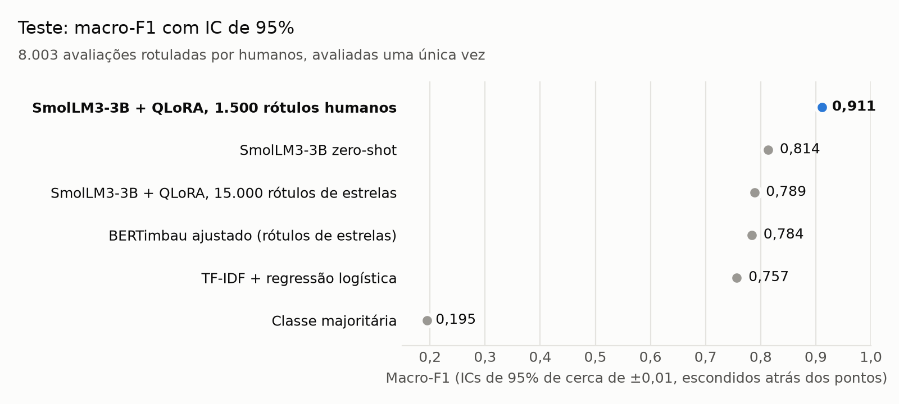
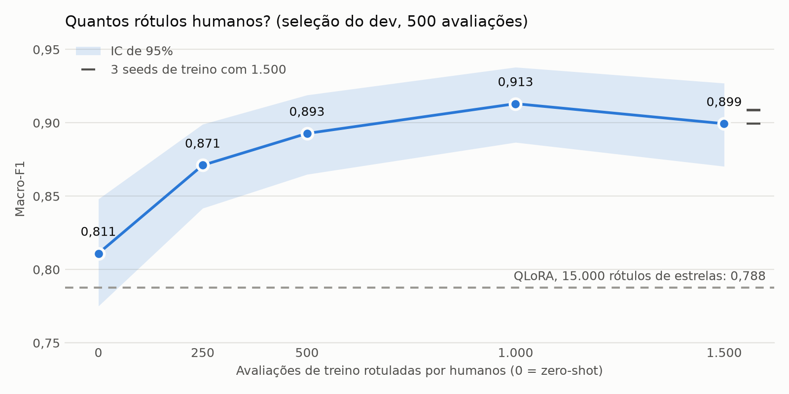

# 1.500 rótulos humanos valeram mais que 15.000 notas em estrelas

*Fine-tuning de um LLM pequeno para classificar avaliações de produtos em português, numa GPU
gratuita, e o que os experimentos mostraram de verdade.*

Pedro Ricci · novembro de 2026 · código:
[github.com/PedroRicci12/ptbr-review-lora](https://github.com/PedroRicci12/ptbr-review-lora) ·
modelo:
[huggingface.co/PedroRicci12/smollm3-3b-ptbr-review-sentiment-qlora](https://huggingface.co/PedroRicci12/smollm3-3b-ptbr-review-sentiment-qlora)

---

## A pergunta

Quem vende online recebe milhares de avaliações por dia, e ler todas não dá. Classificar cada uma
como **negativa**, **neutra** ou **positiva** é um problema antigo de NLP, mas continua útil, e
virou um bom campo de teste para uma pergunta mais atual: **vale a pena fazer fine-tuning de um
LLM pequeno para uma tarefa assim, ou basta pedir com um bom prompt?**

Montei o projeto para responder isso com números, usando só ferramentas gratuitas: um modelo
aberto de 3 bilhões de parâmetros (SmolLM3-3B), uma GPU T4 do Kaggle e dois datasets públicos em
português. A regra desde o primeiro dia foi medir antes de otimizar e registrar também o que deu
errado.

## Os dados, e o problema escondido neles

A fonte mais óbvia de rótulos são as estrelas que o próprio cliente dá. A
[B2W-Reviews01](https://github.com/americanas-tech/b2w-reviews01) tem cerca de 130 mil avaliações
da Americanas.com com nota de 1 a 5. A conversão parece natural: 1–2 estrelas é negativo, 3 é
neutro, 4–5 é positivo.

Para avaliar, usei o [RePro](https://huggingface.co/datasets/lucasnil/repro), um subconjunto de
10 mil dessas avaliações em que **pessoas anotaram a polaridade do texto**. Separei 2.000 para
desenvolvimento (dev) e deixei 8.003 trancadas como teste final. As avaliações do RePro foram
removidas do conjunto de treino, inclusive 130 que reapareciam com texto idêntico.

O primeiro número que medi já mudou o projeto: **no dev, o rótulo das estrelas concorda com o
rótulo humano em só 74,4% das avaliações**. E o erro não é aleatório. Uma avaliação de 3 estrelas
vira "neutro" pela regra, mas muitas delas são positivas no texto ("Bom produto, mas demorou a
chegar"). As estrelas medem a satisfação com a compra; os anotadores leram o sentimento do texto.

Outro detalhe pesa na métrica. No RePro, "neutro" inclui as avaliações **mistas**, com pontos
positivos e negativos ao mesmo tempo. É a classe mais difícil, e é por isso que a métrica
principal é o **macro-F1**, a média do F1 das três classes: um modelo que acerta muito o positivo
e erra o neutro não se esconde atrás da acurácia.

## Como medi

Antes de treinar qualquer coisa, fixei as regras:

- **Toda escolha é feita no dev.** Hiperparâmetros, prompts e checkpoints foram decididos ali.
- **O teste é usado uma única vez**, no fim, para todos os modelos juntos.
- **Intervalos de confiança em tudo**, por bootstrap, e comparações pareadas entre modelos
  (os dois avaliados nas mesmas reamostras).
- **Pré-registro:** antes de rodar o teste, commitei no repositório as três hipóteses, a correção
  de Bonferroni para comparações múltiplas e a regra de veredito. Assim, nenhuma comparação podia
  ser escolhida depois de ver os números.

Os concorrentes, em ordem de custo:

1. **TF-IDF + regressão logística**, treinada em ~25 segundos na CPU de um notebook.
2. **BERTimbau**, um BERT em português, ajustado com os rótulos de estrelas (~25 min numa T4).
3. **SmolLM3-3B sem treino nenhum**, só com uma instrução (zero-shot) ou com 6 exemplos no
   prompt (6-shot).
4. **SmolLM3-3B com QLoRA**, em duas versões: com **15.000 rótulos de estrelas** e com
   **1.500 rótulos humanos** (do próprio dev, separados das 500 avaliações usadas para escolher o
   checkpoint).

Em uma frase, **QLoRA** é: congelar o modelo em 4 bits para caber na GPU e treinar só pequenas
matrizes extras (as LoRA) presas a cada camada. Aqui foram 30 milhões de parâmetros treináveis,
cerca de 1% do modelo.

Para transformar o LLM em classificador, não pedi que ele escrevesse a resposta livremente. Para
cada avaliação, calculei a probabilidade de o modelo responder "negativo", "neutro" ou
"positivo" e escolhi a maior. Assim a saída é sempre um rótulo válido. Conferi também a geração
livre: as duas formas concordaram em 99,85% das avaliações.

## O resultado

| Modelo (teste, 8.003 avaliações) | Macro-F1 (IC 95%) | F1 `neutro` |
|---|---|---|
| Classe majoritária | 0,195 (0,191–0,198) | 0,000 |
| TF-IDF + regressão logística | 0,757 (0,747–0,766) | 0,558 |
| BERTimbau ajustado (estrelas) | 0,784 (0,775–0,793) | 0,618 |
| SmolLM3-3B + QLoRA, 15.000 estrelas | 0,789 (0,780–0,798) | 0,618 |
| SmolLM3-3B zero-shot | 0,814 (0,804–0,823) | 0,634 |
| **SmolLM3-3B + QLoRA, 1.500 rótulos humanos** | **0,911** (0,904–0,917) | **0,846** |

As três hipóteses pré-registradas (diferença de macro-F1, IC de 98,3% com Bonferroni):

- **H1:** QLoRA humanos vs zero-shot: **+0,097** (+0,086 a +0,109). Melhor.
- **H2:** QLoRA estrelas vs zero-shot: **−0,025** (−0,037 a −0,013). **Pior.**
- **H3:** QLoRA humanos vs QLoRA estrelas: **+0,122** (+0,110 a +0,134). Melhor.

Três coisas chamam atenção.

**O modelo base já era a baseline mais forte.** Sem treino, só com uma instrução, o SmolLM3-3B
superou o BERTimbau ajustado (+0,029, IC +0,019 a +0,040). Se eu tivesse pulado a medição do
modelo base, teria comparado o fine-tuning com um adversário mais fraco e superestimado o ganho.

**Fine-tuning com rótulos ruins piorou o modelo.** Dez vezes mais dados, mais de três vezes mais
tempo de treino (134 contra 41 minutos), e o resultado ficou abaixo de não treinar. O F1 do
positivo caiu de 0,940 para 0,851: o modelo aprendeu a regra "3 estrelas = neutro", e com ela
passou a chamar de neutras avaliações que os humanos leram como positivas. O modelo com estrelas
também concordou com o BERTimbau em 95,4% das avaliações do dev: com os mesmos rótulos, um
encoder de 110 milhões e um LLM de 3 bilhões de parâmetros aprenderam quase a mesma coisa. Os
rótulos decidiram mais que a arquitetura.

**O ganho dos rótulos humanos veio quase todo do neutro.** O F1 do neutro subiu de 0,634
(zero-shot) para 0,846. Nas avaliações mistas, o recall foi de 0,52 para 0,90: o modelo aprendeu
a convenção de que "bom, mas…" é neutro.

## Quantos rótulos humanos são necessários?

Rotular custa caro, então a pergunta prática é quanto rotular. Treinei de novo com 250, 500 e
1.000 dos 1.500 exemplos (subconjuntos aninhados e estratificados), medindo nas 500 avaliações de
seleção do dev:

**Com 250 rótulos o modelo já supera o zero-shot** (+0,060, IC +0,025 a +0,094), em 15 minutos de
treino. Depois de uns 500, a curva achata. O ponto de 1.000 (0,913) ficou acima do de 1.500
(0,899), mas a diferença está dentro do ruído: com 500 avaliações de avaliação, os intervalos têm
uns ±0,03 de largura.

Para saber quanto do resultado era sorte, treinei os mesmos 1.500 com outras duas seeds: 0,899,
0,908 e 0,909 (média 0,906, desvio 0,005). A seed do modelo publicado foi a **mais baixa** das
três, então o resultado não depende de uma seed boa.

## O que deu errado (e foi registrado)

- **Few-shot piorou.** No dev, colocar 6 exemplos no prompt baixou o macro-F1 de 0,815 para
  0,760. Os exemplos tinham rótulos de estrelas, então escrevi que o problema era o ruído desses
  rótulos.
- **Minha explicação estava errada.** Numa ablação na seleção do dev, sorteei outros exemplos e
  testei exemplos com rótulos humanos. Os novos sorteios de estrelas ficaram em 0,791 e 0,783; o
  sorteio original, em 0,741. Ou seja, **a queda veio principalmente de um sorteio azarado.** E os exemplos humanos
  (0,799) também não superaram o zero-shot (0,811). Para este modelo, rótulos humanos só renderam
  via fine-tuning.
- **Quantizar custa caro antes de treinar.** Só carregar o modelo em 4 bits, sem treino, derrubou
  o macro-F1 de 0,811 para 0,706 na seleção do dev, e o neutro quase sumiu (F1 0,355). O QLoRA
  recupera isso e mais, mas o modelo publicado deve ser carregado em 4 bits para reproduzir os
  números, porque foi assim que ele foi treinado e medido.
- **Erros de digitação nos meus números.** Quando passei a gerar o model card a partir dos
  arquivos de resultado, em vez de digitar, apareceram dois arredondamentos errados que eu tinha
  escrito à mão (+0,098 em vez de +0,097, por exemplo). Nada mudou de conclusão, mas desde então
  nenhum número do card é digitado.
- **Infraestrutura.** O Colab gratuito ficou sem GPU, então todos os notebooks passaram a rodar
  também no Kaggle. Cada notebook reconstrói os dados e para se as contagens diferirem das do
  repositório, o que permitiu trocar de plataforma sem medo.

## Limitações

- **Mesmo esquema de anotação.** O modelo com rótulos humanos treinou com avaliações do RePro e
  foi testado em outra parte do RePro. Parte do ganho pode ser ter aprendido *aquela* anotação,
  e não rótulos "melhores" em geral. Procurei um dataset em português de outro domínio, com três
  classes anotadas por humanos e procedência verificável, para testar isso, e não encontrei.
- **Possível contaminação.** Os dois datasets são públicos; não verifiquei se estão nos dados de
  pré-treino do SmolLM3. Isso poderia inflar o zero-shot.
- **Domínio único.** Avaliações de produtos de uma loja, de 2018. Restaurantes, delivery ou redes
  sociais não foram testados.
- **Classes artificialmente equilibradas.** O RePro amostrou um número parecido de avaliações por
  nota; numa loja real há bem menos neutras e negativas.
- **Uma seed no teste.** A variância entre seeds só foi medida no dev, para o modelo com rótulos
  humanos.

## O que eu faria diferente

- **Planejar a comparação de rótulos desde o início.** O experimento central (estrelas contra
  rótulos humanos) surgiu no meio do projeto, quando analisei o padrão do ruído das estrelas antes
  do fine-tuning. Com essa pergunta no plano desde o começo, eu teria reservado mais dados
  rotulados para ela.
- **Um conjunto de seleção maior.** Com 500 avaliações (só 20 neutras puras), várias comparações
  ficaram sem resposta. Eu dividiria o dev de outro jeito, ou rotularia mais.
- **Repetir antes de explicar.** A história errada sobre o few-shot teria sido evitada com dois
  sorteios a mais logo na primeira vez. Hoje eu desconfio de qualquer conclusão tirada de uma
  única execução.

## Para levar

Para classificar sentimento em português com um LLM pequeno, **a qualidade dos rótulos pesou mais
que a quantidade de dados e que o tamanho do modelo.** Algumas centenas de exemplos bem rotulados,
com o mesmo critério da avaliação, levaram um modelo de 3B de 0,81 para 0,91 de macro-F1 numa GPU
gratuita. Milhares de rótulos baratos, no mesmo modelo, deixaram o resultado pior que não treinar.

Todo o código, as decisões (com as alternativas descartadas), os resultados negativos e o modelo
estão abertos. O exemplo de uso do model card foi verificado: baixando o adapter do Hugging Face,
ele reproduz exatamente as 500 predições do dev.

---

*Números: todos vêm dos relatórios em
[reports/](https://github.com/PedroRicci12/ptbr-review-lora/tree/main/reports). Decisões e
incidentes: [docs/decisions.md](decisions.md). Código sob licença MIT; dados e modelo sob
CC BY-NC-SA 4.0 (uso não comercial).*
